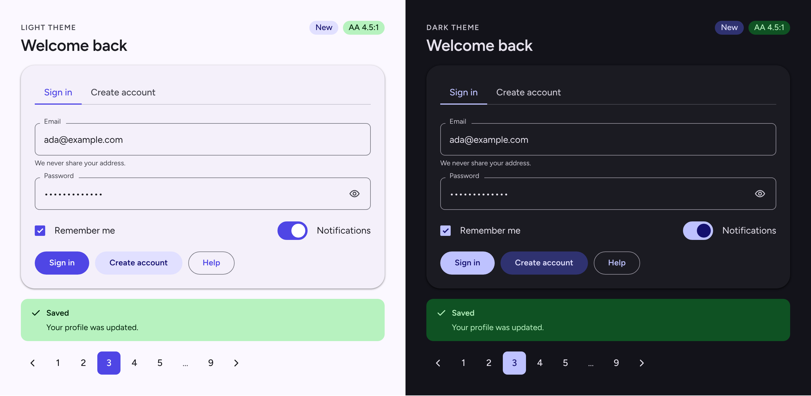

<p align="center">
  <picture>
    <source media="(prefers-color-scheme: dark)" srcset="https://raw.githubusercontent.com/thiagopedro99/enchase/main/public/enchase-logo-branco.svg">
    
  </picture>
</p>

<p align="center"><b>English</b> · <a href="https://github.com/thiagopedro99/enchase/blob/main/README.pt-BR.md">Português</a></p>

# Enchase

Accessible React components, by contract: a theme with validated contrast, CSS first, its own motion, SSR and RTL, and no runtime dependency besides React.

<p align="center">
  
</p>

[Storybook](https://enchase.othiagosilva.com.br/docs/) · [Demo](https://enchase.othiagosilva.com.br/) · [API reference](API.md) · [Changelog](CHANGELOG.md)

> Version `0.x`: the API can still change between minor versions, and the changelog says what changed in each release. [VERSIONING.md](VERSIONING.md) has the rules.

## Install

```bash
npm install enchase
```

`react` and `react-dom` (version 19) are peer dependencies. The package is ESM and ships its types.

The versions of React, the browsers and Node that the library supports are in the [support matrix](#support).

## Support

| | Minimum | Tested on |
| --- | --- | --- |
| React and React DOM | 19 | 19 |
| Chrome | 120 | Chromium, the one of Playwright (`npm run test:browser`) |
| Edge | 120 | the same Chromium: Edge is not tested apart |
| Firefox | 129 | Firefox, the one of Playwright (`npm run test:browser:firefox`) |
| Safari | 17.5 | WebKit, the one of Playwright on Linux (`npm run test:browser:webkit`): Safari itself is not tested |
| iOS Safari | 17.5 | the same WebKit: an iPhone is not tested |
| Node | 22 | 22, the version that CI runs |
| Next.js | not declared | 15 (`npm run test:next`), with the App Router and Server Components |
| Vite | not declared | 8 (`npm run test:eject`) |

The minimum of the browsers is the `browserslist` field of `package.json`, which also sets the target of the published CSS, and the minimum of Node is the `engines` field, which the `enchase eject` command and the build follow. Raising a minimum is a breaking change, as [VERSIONING.md](VERSIONING.md) says. The suites run on the latest version of each engine, so the minimum is what the library declares and compiles for, and not a version where every test ran.

The one hard requirement of the browsers is `inert`, which isolates the page behind a modal (Chrome 102, Safari 15.5 and Firefox 112). The rest degrades gracefully in an older browser: without `@starting-style` the entry animation is gone, without `linear()` the spring falls back to the `ease` curve, and without `color-mix()` some state backgrounds (hover and disabled) don't show.

## Quick start

### Next.js (App Router)

```tsx
import { ColorModeProvider, ColorModeScript, GlobalStyles, ToastProvider, UIProvider } from 'enchase'
import 'enchase/styles.css'

export default function RootLayout({ children }: { children: React.ReactNode }) {
  return (
    <html lang="en" suppressHydrationWarning>
      <head>
        <ColorModeScript />
      </head>
      <body>
        <ColorModeProvider>
          <GlobalStyles />
          <UIProvider>
            <ToastProvider>{children}</ToastProvider>
          </UIProvider>
        </ColorModeProvider>
      </body>
    </html>
  )
}
```

`ColorModeScript` applies the saved or system color mode before the first paint, which is why `<html>` has `suppressHydrationWarning`.

### Vite

```tsx
import { createRoot } from 'react-dom/client'
import { ColorModeProvider, GlobalStyles, ToastProvider, UIProvider } from 'enchase'
import 'enchase/styles.css'

import App from './App.tsx'

createRoot(document.getElementById('root')!).render(
  <ColorModeProvider>
    <GlobalStyles />
    <UIProvider>
      <ToastProvider>
        <App />
      </ToastProvider>
    </UIProvider>
  </ColorModeProvider>
)
```

The default font is Figtree: load it in your app (for example with `@fontsource-variable/figtree`) or set another family in the theme.

`GlobalStyles` is optional. It adds a small stylesheet, in `@layer enchase-base`: a reset of `box-sizing`, margin and padding, the theme's font, color and background on `<body>`, the size of the headings, thin scrollbars, the focus ring (with the scroll margin that keeps it in view), the selection color and shortened animations under `prefers-reduced-motion`. Leave it out if your app already has its own base styles: the components style themselves. In that case, give `<body>` the theme's colors (`background-color: var(--enchase-color-background)` and `color: var(--enchase-color-text-primary)`) and set `scrollbar-gutter: stable` on `<html>`, so the page doesn't shift sideways when a modal locks the scroll.

### Your first screen

```tsx
import { Button, Card, Checkbox, Input } from 'enchase'

export const SignIn = () => (
  <Card variant="elevated">
    <Input label="Email" type="email" helperText="We never share your address." fullWidth />
    <Input label="Password" type="password" passwordToggle fullWidth />
    <Checkbox label="Remember me" defaultChecked />
    <Button>Sign in</Button>
  </Card>
)
```

That one is safe in a Server Component. Hooks need a Client Component:

```tsx
'use client'

import { Button, useToast } from 'enchase'

export const SaveButton = () => {
  const { success } = useToast()

  return <Button onClick={() => success('Saved')}>Save</Button>
}
```

Each toast method (`success`, `error`, `warning`, `info` and `addToast`) returns the id of the notification, which `removeToast` takes to close it. The message can be text or nodes. A third argument takes `className` and `style`, an `action` (`{ label, onClick }`, a button that runs `onClick` and closes the notification) and `dismissible: false` (no close button, no close on click or Esc: it only closes after its duration or with `removeToast`). `useToast` also has `update(id, patch)`, which changes a notification in place (`message`, `type`, `duration`, `action`, `dismissible`, `className` or `style`), and `promise(task, { loading, success, error })`, which shows the loading message as a notification that does not expire and turns it into the result when the promise settles (`success` and `error` can be functions of the value or of the reason, and the call returns the same promise). `ToastProvider` takes `position` (`top-end` by default, `top-start`, `bottom-end` or `bottom-start`, following the direction of the page) and `limit` (the most notifications on screen at once: the others wait in a queue and show up as the visible ones close). The countdown of every notification stops while the pointer or the keyboard focus is anywhere in the region. The notification region is a named `role="region"` and not a live region: two hidden announcers, created with the `ToastProvider` and before the first notification, read each toast aloud, with `role="status"` for success, info and warning and `role="alert"` for error. In your own tests, a query such as `getByRole('alert')` also finds the empty announcer: scope it with `within` or look for the text.

## Components

- **Actions:** `Button`, `ButtonLink`, `Link`, `ThemeToggle`
- **Forms:** `Input`, `Textarea`, `NumberInput`, `Select`, `Combobox`, `DatePicker`, `Checkbox`, `CheckboxGroup`, `Switch`, `RadioGroup`, `SegmentedControl`, `Slider`
- **Content:** `Accordion`, `Alert`, `Avatar`, `Badge`, `Card`, `CardButton`, `CardLink`, `Divider`, `Skeleton`, `Table`, `Tabs`, `Tag`
- **Feedback and overlays:** `Loading`, `InlineLoading`, `Progress`, `Modal`, `ConfirmModal`, `Drawer`, `Popover`, `Menu`, `Tooltip`, and the toasts (`ToastProvider` and `useToast`)
- **Navigation and layout:** `Breadcrumbs`, `Footer`, `Layout`, `Navbar`, `Pagination`, `Sidebar`, `Container`, `Flex`, `Grid`
- **Utilities:** `Icon`, `VisuallyHidden`, and the 20 icons the components use inside, in `enchase/icons`

Each one has a page in the [Storybook](https://enchase.othiagosilva.com.br/docs/) and a section in [API.md](API.md).

## Make it yours

`ColorModeProvider` takes a `theme`. Three options cover most apps:

```tsx
import { ColorModeProvider } from 'enchase'
import { shadcn } from 'enchase/styles/shadcn'

export const Providers = ({ children }: { children: React.ReactNode }) => (
  <ColorModeProvider theme={{ style: shadcn, brand: '#0F766E', shape: 'soft' }}>{children}</ColorModeProvider>
)
```

- `brand` is one color (hex or `rgb()`, without transparency), and `createTheme` derives the light and dark palettes from it. The tests of the library sweep hundreds of brand colors, from very light to very dark and from gray to vivid, and require that `validateTheme` finds no pair below the minimum contrast.
- `shape` is the corner radius: `pill` (the default), `soft` or `square`.
- `style` changes the look of the whole kit at once. `enchase` is the default, and `shadcn` comes closer to shadcn/ui: a neutral palette, borders instead of shadows, 36 px controls and the label above the field. `workbench` is a neutral, dense look for work screens (24, 32 and 40 px controls, 1 px borders, a blue primary and a compact density of its own), inspired by the visual language of Ant Design (MIT): a style of Enchase, not a port and not compatible with `antd`. Each style is its own entry (`enchase/styles/<name>`), so only the one you import reaches your bundle.

What you pass overrides the style, and your own CSS overrides both: every part has a `data-slot` and reads variables named `--enchase-<slot>-<property>`, and the full list, generated from the CSS, is in [API.md](API.md). In development the provider warns in the console about color pairs below the minimum contrast. Outside React (build, server, CI), run `validateTheme(createTheme(theme))` from `enchase/theme`.

## Eject

When the CSS hooks, the styles and the props are not enough, `enchase eject` copies the source of a component into your project, and from then on the code is yours:

```bash
npx enchase eject Button Tabs
npx enchase eject --diff Button
```

The copies keep importing from `enchase` whatever the package already exports, and share its contexts and overlays, so they work next to the components of the package. Nothing updates a copy, and `--diff` tells what the library changed since you ejected; the accessibility contract holds for what the package publishes, not for a copy that you change. The command is stable since 0.20: its commands, its options and the format of `enchase.eject.json` are part of the public API, and the layout of the files of a component is not. If it is the behavior of five components that you want under your own markup, the headless hooks below are lighter than a copy. [EJECT.md](EJECT.md) has the rest: what eject promises and what it does not, what is copied, what your project needs, and the license that travels with the code.

## Headless hooks

When the markup has to be yours, five components have a hook that gives you their behavior (the state, the keyboard, the roles and the ARIA attributes) and none of their markup or CSS. They are part of the stable API since 0.20:

```tsx
'use client'

import { useTabs } from 'enchase/headless/tabs'

const items = [{ value: 'one' }, { value: 'two' }]

export const MyTabs = () => {
  const tabs = useTabs({ items })

  return (
    <div>
      <div {...tabs.getListProps({ 'aria-label': 'Sections' })}>
        {items.map((item) => (
          <button key={item.value} {...tabs.getTabProps(item.value)}>
            {item.value}
          </button>
        ))}
      </div>

      {items.map((item) => (
        <div key={item.value} {...tabs.getPanelProps(item.value)}>
          {item.value} panel
        </div>
      ))}
    </div>
  )
}
```

Each hook has an entry of its own, `enchase/headless/tabs`, `pagination`, `segmented-control`, `accordion` and `slider`, which starts with `'use client'` and brings no CSS and no component. The old `enchase/experimental/<name>` paths still work, flagged as deprecated, and go away in 1.0. A getter takes the value of the item and, as a last argument, your own props, where your handlers run first and your `ref` and your `id` are kept. [HEADLESS.md](HEADLESS.md) has the rules and an example of each hook.

## Density

`data-density="compact"` on `<html>` tightens the whole kit: shorter controls and bars, 32 px targets and a tighter space scale. It is plain CSS, with no prop and no API of its own.

```html
<html lang="en" data-density="compact">
```

In Next.js (App Router) that is the `<html>` of the root layout. From the client, set `document.documentElement.dataset.density = 'compact'` and go back with `document.documentElement.removeAttribute('data-density')`; switching at run time works. The attribute goes on `<html>` and only there, unlike `data-theme`: on a `div` or on `<body>` it does nothing, so there are no density islands. There is no `spacious` and no way back to the default inside a compact tree, and the type, the radius and the drawing of the checkbox, the radio, the switch, the icons and the avatar do not change.

- **Not for touch-first interfaces.** The target size goes down to 32 px with any pointer. The floor of 24 px (WCAG 2.5.8) still holds, and `--enchase-hit-size-lg`, for the buttons that open, close or collapse a navigation, stays at 44 px.
- **A style can carry its own compact.** `defineStyle` takes `density: { compact: { tokens, hooks } }`, which takes the place of the default block while the style is active; `workbench` does it, with 10 tokens and 30 hooks, and keeps the targets at 24 px or more without shrinking the type. `enchase` and `shadcn` declare none, and their CSS is the one of before.
- **The `shadcn` style is half compact.** It declares its own measures, so it follows the tokens (buttons, fields, tabs and paddings) and keeps the heights that it fixes itself: the accordion, the table rows, the menu items, the sidebar and the bars.
- **Your own tokens.** In `enchase/styles.css`, which has no layer, a token of yours on `:root` loses to the compact block. Use `enchase/styles.layer.css` with `cssLayer="enchase-theme"`, where your CSS without a layer always wins, or write `html:root[data-density='compact'] { ... }`. A hook of yours wins in both.

The Storybook has a Density item in the toolbar and a System/Density page with the tokens, the hooks and the size of each part in the three styles, and what `shadcn` follows and what it does not.

## Good to know

- **No router needed.** `Link`, `ButtonLink`, the items of `Sidebar` and `Navbar`, `Breadcrumbs` and the links of `Footer` are real `<a href>`. Give `UIProvider` a `navigate` function and a plain click on a route of your app goes through it; without one, the links reload the page. `currentHref` marks the active item.
- **Languages and RTL.** The accessibility texts come from the `locale` of `UIProvider`: English by default, and `ptBR` ships in `enchase/locales`. A custom locale with `dir: 'rtl'` covers right-to-left languages. The `DatePicker` and the `NumberInput` also take their own `locale` prop, a BCP 47 tag such as `en-GB` or `de`, to write, read and name their dates and numbers in another language than the provider's, while their texts and their direction still come from the provider. The CSS uses logical properties, and what has to be mirrored (the directional icons, the thumb of the switch, the notch of the floating labels) follows the `dir` attribute of the document or of an ancestor, whatever its `lang`, through plain attribute selectors that no build step rewrites. Setting `dir="rtl"` on `<html>` is up to your app, and a `dir="ltr"` island inside a right-to-left page is not un-mirrored. The tag also decides how dates and numbers are written, and a malformed tag (`en_US`, an empty string) or one that the `Intl` of the environment does not know (`xx`, or any language but English on a Node built with `small-icu`) falls back to `en` with no error: the server and the browser write the same date or number only if both know the tag, so run the server on a Node with full ICU (the official builds, since Node 13) and use standard BCP 47 tags such as `en-GB` (WebKit does not normalize `en-UK`).
- **Server rendering.** The components render on the server without hydration errors. The package is marked `'use client'`, so server pages and layouts import the components directly.
- **Forms.** The fields work with react-hook-form and a Zod schema, with no adapter, and the [forms guide](https://enchase.othiagosilva.com.br/docs/?path=/docs/system-forms-guide--docs) in the Storybook has a complete form to copy. A validation message goes in the `error` prop of the field, which marks it with `aria-invalid` and announces the message as an alert.
- **Overlays and local themes.** `Modal`, `ConfirmModal`, `Drawer`, `Popover`, `Menu`, the list of the `Combobox`, the calendar of the `DatePicker`, `Tooltip`, the `Loading` overlay and the notification region of `ToastProvider` render in a portal on `<body>`. The theme reaches them, because its variables live on `:root` and `[data-theme]`, but a variable that you override on an element of your app does not, because inheritance follows the DOM tree. Pass `container`, an element or a function that returns one, to render the overlay inside that element so it inherits your overrides; a notification region inside the page stays reachable when a modal makes the rest of the page inert. The overlays are `position: fixed`, so an ancestor of the container with `transform`, `filter` or `contain` moves them, and one that creates a stacking context (`z-index`, `opacity`, `isolation`) confines their `z-index` to it: pick a container without those.
- **Two stylesheets.** `enchase/styles.css` is the one in the quick start. `enchase/styles.layer.css` is the same CSS inside `@layer enchase`, so any unlayered CSS of yours wins in any order. Import one of them, never both.
- **Only the CSS you use.** `enchase/css/<name>.css` is the CSS of one component (`button.css`, `button-link.css`, `date-picker.css`): the rules of `enchase/styles.css`, cut by component, so an app that uses a few components ships less CSS. A component can need the CSS of others, and `enchase/css/index.json` says which: for each component it gives the `file`, the `needs` to import before it (in the order to import them: `button-link` needs `icon`, `button` and `visually-hidden`), the CSS modules of the sources that make the file (`files`) and its size in `bytes` and in `gzip`. To use several components, import the union of their `needs` and of the components, in the order of the map, as `import 'enchase/css/icon.css'` and then `import 'enchase/css/button.css'`; to put them in a layer, declare `@layer enchase-theme, enchase-base, enchase;` and `@import 'enchase/css/button.css' layer(enchase);`. Use these files or `enchase/styles.css`, never both, and keep `enchase/theme.css` for the theme.

## Package entries

| Entry | Contents |
| --- | --- |
| `enchase` | Components, providers, hooks and types. Marked `'use client'`. |
| `enchase/theme` | `createTheme`, `defineStyle`, `validateTheme`, `validateMotion`, `contrastChecks`, `contrastRatio`, `spring`, `timedSpring`, `themeCss` and the tokens (`baseTokens`, `defaultTheme`, `lightTheme`, `darkTheme`, `breakpoints`, `colorRoles`, `themeModes`, `defaultThemeCss`), with their types. Nothing else is public. No React. |
| `enchase/styles/<name>` | One visual style per entry: `enchase/styles/shadcn`, `enchase/styles/workbench` and `enchase/styles/enchase`. Data only, no React, and only in the bundle of whoever imports it. |
| `enchase/locales` | `en` and `ptBR` (`{ locale, dir, messages }`). Data only. |
| `enchase/icons` | The 20 icons the components use inside, one component per icon. Works in Server Components. |
| `enchase/headless/<name>` | One headless hook per entry (`tabs`, `pagination`, `segmented-control`, `accordion` and `slider`), with its types. For Client Components, with no CSS and no component. |
| `enchase/experimental/<name>` | The old path of the same five hooks: a deprecated alias, removed in 1.0. Use `enchase/headless/<name>`. |
| `enchase/styles.css` | The CSS of the components. |
| `enchase/styles.layer.css` | The same CSS inside `@layer enchase`. |
| `enchase/css/<name>.css` | The CSS of one component, cut from `enchase/styles.css`. `enchase/css/index.json` is the map: the file of each component and the files it needs. |
| `enchase/theme.css` | The variables of the default theme, light and dark, as a static file. |

Consumers import only from these entries. The internal code (`src/`) is not public.

## What is verified, and what is not

The contract in full, with the test or the script behind each claim, is in [ACCESSIBILITY.md](ACCESSIBILITY.md).

Verified by automated tests:

- Every component passes axe (vitest-axe) in jsdom, and the flows of focus, `inert`, scroll lock, stacked Esc and focus restoration run in real Chromium, Firefox and WebKit.
- The color pairs of the default palette (light and dark) reach 4.5:1 for text and 3:1 for field borders and the focus ring. `createTheme` throws on an invalid color, and `validateTheme` lists the pairs below the minimum.
- Interactive targets are at least 24 × 24 px, and the components respect `prefers-reduced-motion` (the movement goes away, the fade stays).
- Server rendering and hydration run without errors in 6 environment variants (width, saved theme, dark system and reduced motion), plus a minimal Next 15 app (`npm run test:next`) that imports the components in a Server Component.
- Your `className` wins over the library's in both stylesheets and in any load order, and an element selector of yours loses to it, proved in browsers. [STYLING.md](STYLING.md) says what wins over what.
- The compact density, in real Chromium, Firefox and WebKit: the size of each part in both styles, targets of 24 px or more (but the thumb of the `Slider`), the same default look with no attribute, nothing changing when the attribute is on an element other than `<html>`, and the precedence against the layered stylesheet and against your CSS.

Not guaranteed:

- Full WCAG conformance. The library checks what its tokens and tests cover, and it does not replace an audit or testing with screen readers: nothing was tested with NVDA, JAWS or VoiceOver (the script for that test is in [ACCESSIBILITY.md](ACCESSIBILITY.md#screen-reader-tests-not-run-yet) and has not been run), and manual review in real Safari is still needed.
- The contrast of custom themes written in `hsl()`, `oklch()` or `oklab()`. Those formats are not measured, and the warning says how many pairs went unchecked.
- Velocity gestures (swipe to dismiss, inertia) and a Material 3 style. They don't exist yet.
- The compact density outside the built-in styles. The default block is a set of absolute values chosen for `enchase` and `shadcn` (`workbench` brings its own compact): a style of your own, made with `defineStyle`, receives the same block and can replace it with its own compact (`density`), but the values it declares are its own and the library does not check them against the default size of the style, so in a style whose default is already denser, some parts may not compact, or may even grow (the floor of 24 px still holds).

## Documentation

- [Storybook](https://enchase.othiagosilva.com.br/docs/): every component, interactive, plus the pages about the theme, the shape, the styles, the density and the motion.
- [EJECT.md](EJECT.md): `enchase eject`, to copy a component into your project and own the code.
- [HEADLESS.md](HEADLESS.md): the hooks that give the behavior of five components without their markup.
- [VERSIONING.md](VERSIONING.md): what is the public API, what a breaking change is, how a deprecation works and what experimental means.
- [ACCESSIBILITY.md](ACCESSIBILITY.md): what is tested, in which engines, and what is not, screen readers included.
- [MIGRATION.md](MIGRATION.md): what to check when you upgrade, one page for each minor version since 0.10.
- [SECURITY.md](SECURITY.md): how to report a vulnerability in private, and what to expect.
- [API.md](API.md): props, types, defaults, hooks and CSS hooks of every component. It ships inside the package, in `node_modules/enchase/API.md`.
- [README.pt-BR.md](https://github.com/thiagopedro99/enchase/blob/main/README.pt-BR.md): the full guide, with routing and how each `href` is handled, the theme in depth, how to create a style, motion, customization by CSS, the density, server rendering and tests.

The Storybook, `API.md` and `CONTRIBUTING.md` are in English. The full guide is `README.pt-BR.md`, in Portuguese.

## Contributing

See [CONTRIBUTING.md](CONTRIBUTING.md).

## License

MIT. See the [LICENSE](LICENSE) file.

## Author

**Thiago Silva** — [GitHub](https://github.com/thiagopedro99)
